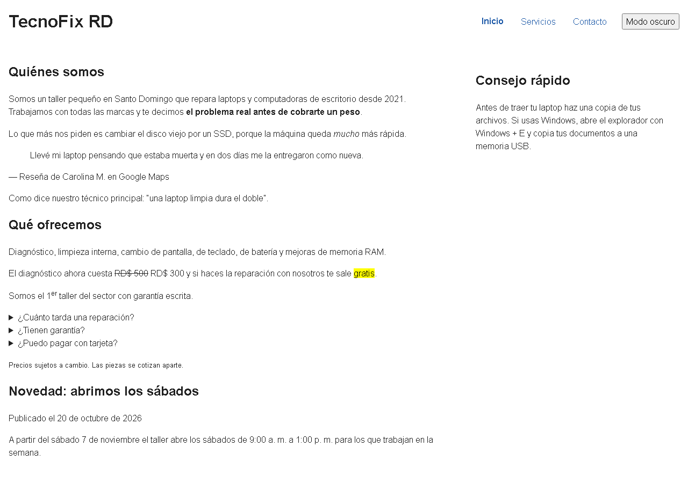
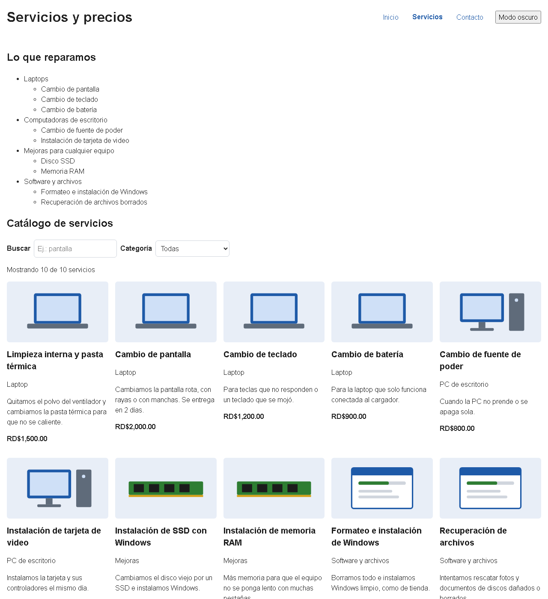
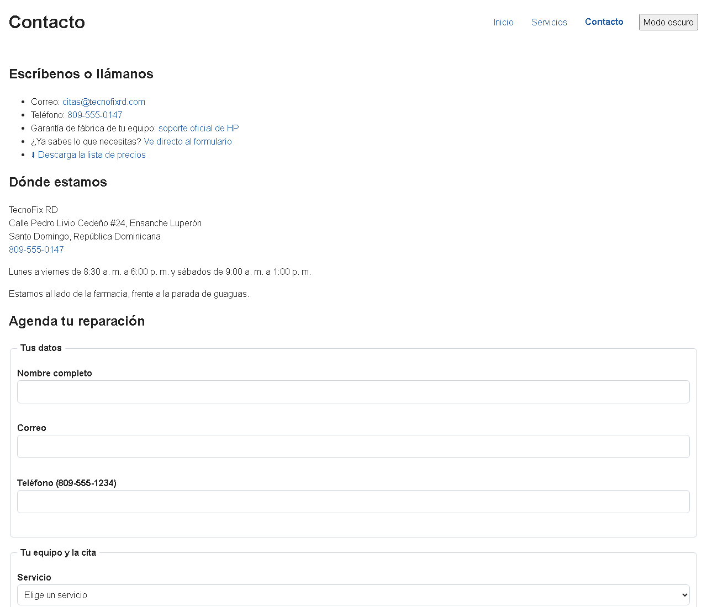
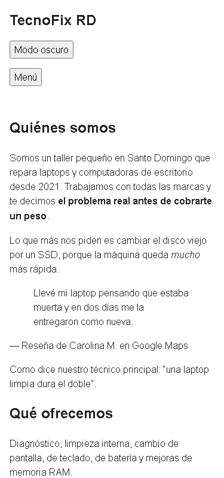
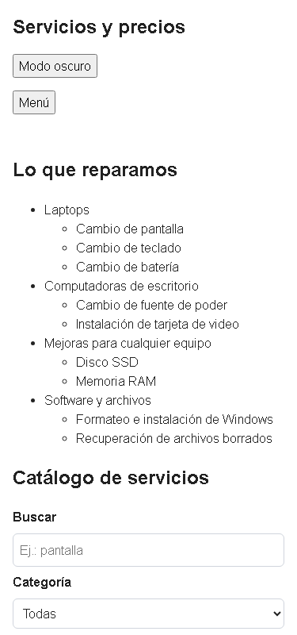

# TecnoFix RD

TecnoFix RD es un taller pequeño de reparación de laptops y computadoras en Santo Domingo. El sitio tiene tres páginas: la portada con quiénes somos y una novedad, el catálogo de servicios con precios, y la página de contacto con el formulario para agendar una reparación. Está hecho con HTML5, una hoja de CSS propia y JavaScript puro, sin frameworks ni librerías.

**Sitio publicado:** https://pxlarizedl.github.io/sitio-tecnofix/
**Repositorio:** https://github.com/PXLARIZEDL/sitio-tecnofix
**Autor:** Ricardo Pimentel · Matrícula 2023-3776
**Materia:** ISW-311 Tecnologías de Internet I

## Capturas







## Estructura de archivos

```
sitio-tecnofix/
├── index.html
├── servicios.html
├── contacto.html
├── css/estilos.css      una sola hoja para las tres páginas
├── js/app.js            un solo script, cargado con defer
├── img/                 dibujos SVG de las tarjetas del catálogo
├── media/               el video y la lista de precios en CSV
├── docs/
│   ├── documentacion.pdf
│   └── capturas/
└── README.md
```

## Mapa de etiquetas

| Familia | Página y sección | Etiquetas usadas | ¿Por qué esa etiqueta? |
|---|---|---|---|
| Cimientos | Las tres, en el `head` | `<!DOCTYPE html>`, `html lang="es"`, `meta charset`, `meta viewport`, `title`, `meta description`, `link`, `script defer` | El doctype y el `lang="es"` le dicen al navegador que es HTML5 en español. El UTF-8 es para las tildes y la ñ, y el viewport para que se vea bien en el celular. Cada página tiene su propio title y description. El `link` trae el CSS y el `script` con `defer` trae el JavaScript después de que carga el HTML. |
| Encabezados y párrafos | Las tres | `h1`, `h2`, `h3`, `p` | Un solo `h1` por página, cada sección arranca con su `h2` y uso `h3` dentro de las secciones (las tarjetas del catálogo y "Nuestro trabajo") sin saltarme niveles. |
| Texto, citas y código | index.html, "Quiénes somos", "Qué ofrecemos" y "Consejo rápido" | `strong`, `em`, `mark`, `del`/`ins`, `abbr`, `small`, `sup`, `blockquote` + `cite`, `q`, `kbd` | `strong` para lo más importante, `em` para el énfasis, `del`/`ins` para el precio viejo y el nuevo, `mark` para resaltar que sale gratis, `abbr` para SSD y RAM, `sup` en 1ᵉʳ, `small` para la letra pequeña, `blockquote` con `cite` para la reseña de una clienta, `q` para una frase corta y `kbd` para las teclas Windows + E. |
| Listas | servicios.html, "Lo que reparamos", "Cómo pedir" y "Palabras que vas a oír" | `ul` con sublista, `ol type="A"`, `dl`/`dt`/`dd` | Los servicios no tienen orden, por eso `ul`, con su sublista dentro del `li`. Los pasos sí van en orden, por eso `ol` con letras. Los términos del taller son palabra y significado, eso es una `dl`. Las tarjetas del catálogo también son una `ul`. |
| Enlaces | contacto.html, "Escríbenos o llámanos"; servicios.html, "Tabla de precios"; el `nav` de las tres | `a` con `mailto:`, `tel:`, `#formulario`, `download`, `target="_blank" rel="noopener"`, `aria-current="page"` | `mailto:` abre el correo, `tel:` llama desde el celular, `#formulario` baja al formulario, `download` baja la lista de precios y el de HP abre en otra pestaña con `noopener` por seguridad. En el menú, `aria-current="page"` marca la página donde uno está. |
| Imágenes y multimedia | servicios.html, "Catálogo" y "Nuestro trabajo" | `figure`, `figcaption`, `img` con `alt`, `video` con `controls` y `source`, `iframe` con `title` | Las fotos van en `figure` con su `figcaption`. El `alt` dice lo que se ve. El video tiene `controls` y `source` con el tipo. El mapa es un `iframe` con `title` para el lector de pantalla. |
| Tablas | servicios.html, "Tabla de precios" | `table`, `caption`, `thead`, `tbody`, `tfoot`, `th scope="col"`, `th scope="row"`, `rowspan`, `colspan` | Los precios son datos con filas y columnas. "Laptop" y "PC de escritorio" usan `rowspan` porque se repiten y el diagnóstico usa `colspan` en el `tfoot`. |
| Formularios | contacto.html, "Agenda tu reparación" | `form novalidate`, `fieldset`, `legend`, `label`, `input` (text, email, tel, number, date, time, file, radio, checkbox), `select` con `optgroup`, `textarea`, `button type="submit"`, `span.error` | Dos `fieldset`: los datos de la persona y los del equipo. Cada `label` tiene `for` igual al `id`. Uso `required`, `minlength`, `maxlength`, `pattern` y `min`/`max`. Debajo de cada campo obligatorio hay un `span class="error"` unido con `aria-describedby` donde el JavaScript escribe el error. El `novalidate` es para que los errores los muestre mi JavaScript y no las burbujas del navegador. |
| Semántica y div/span | Las tres | `header`, `nav`, `main`, `section`, `article`, `aside`, `footer`, `time`, `address`, `details`/`summary`, un `div` | La noticia es `article` porque se entiende sola, el consejo es `aside` porque es aparte del tema, las fechas van en `time`, la dirección en `address` y las preguntas en `details`/`summary`. El único `div` es el que envuelve la tabla para que se desplace de lado en el celular, porque ahí no hay una etiqueta con significado. |

## Diseño con CSS

| Qué | Dónde en `estilos.css` | Cómo |
|---|---|---|
| Variables | 1. Variables | 10 variables en `:root` (colores, letra, espacio y radio) usadas con `var()` |
| Base | 2. Base | `box-sizing: border-box`, letra `Arial, Helvetica, sans-serif`, imágenes con `max-width: 100%` |
| Layout | 3. Layout | El `body` es una grilla de 3 filas para que el footer quede abajo; el header y el menú con Flexbox; la portada en 2 columnas (main y aside) |
| Catálogo | 4. Componentes | Las tarjetas con `grid-template-columns: repeat(auto-fit, minmax(220px, 1fr))` |
| Estados | 5. Estados | Transiciones en el menú y los botones; `:focus-visible`; clase `.invalido` y mensajes `.error` |
| Modo oscuro | 6. Modo oscuro | `body.oscuro` solo cambia los valores de las variables |
| Responsive | 7. Responsive | A 768 px la portada pasa a una columna y sale el botón de menú; a 480 px las tarjetas van una por fila y los filtros uno debajo del otro |

## Funcionalidades de JavaScript

| Funcionalidad | Página | Evento | Función principal |
|---|---|---|---|
| Menú hamburguesa | Las tres | `click` | `alternarMenu()` |
| Modo oscuro recordado con `localStorage` | Las tres | `click` | `alternarTema()` y `aplicarTema()` |
| Año automático en el footer | Las tres | al cargar | `new Date().getFullYear()` |
| Botón de volver arriba | Las tres | `scroll` y `click` | `revisarScroll()` y `subirArriba()` |
| Tarjetas del catálogo desde un arreglo de 10 servicios | servicios.html | al cargar | `pintarTarjetas()` |
| Buscador y filtro por categoría con contador | servicios.html | `input` y `change` | `filtrarCatalogo()` |
| Precios en pesos dominicanos | servicios.html | al pintar | `formatearPrecio()` |
| Validación del formulario | contacto.html | `submit` | `enviarFormulario()` y `validarFormulario()` |
| Reglas propias: teléfono 809/829/849, fecha que no sea pasada, domingo cerrado | contacto.html | `submit` | `validarTelefono()`, `esFechaPasada()`, `esDomingo()` |
| Borrar el error al corregir el campo | contacto.html | `input` | `revisarCampo()` |

## Cómo ejecutarlo

Abrir `index.html` con la extensión Live Server de VS Code o visitar el enlace publicado. Desde el menú se llega a las otras dos páginas.

## Validación

Las tres páginas pasan [validator.w3.org](https://validator.w3.org/nu/) sin errores y `css/estilos.css` pasa [jigsaw.w3.org/css-validator](https://jigsaw.w3.org/css-validator/) sin errores. La consola de DevTools no muestra errores en ninguna página.

## Lo que aprendí

- Que antes de poner un `div` hay que buscar si existe una etiqueta con significado, casi siempre la hay.
- Que con variables en `:root` el modo oscuro es solo cambiar los valores, sin repetir reglas.
- Que un solo `app.js` sirve para las tres páginas si antes de usar un elemento reviso que exista con un `if`.
- Que validar con JavaScript no reemplaza los atributos de HTML: los dos se complementan.
